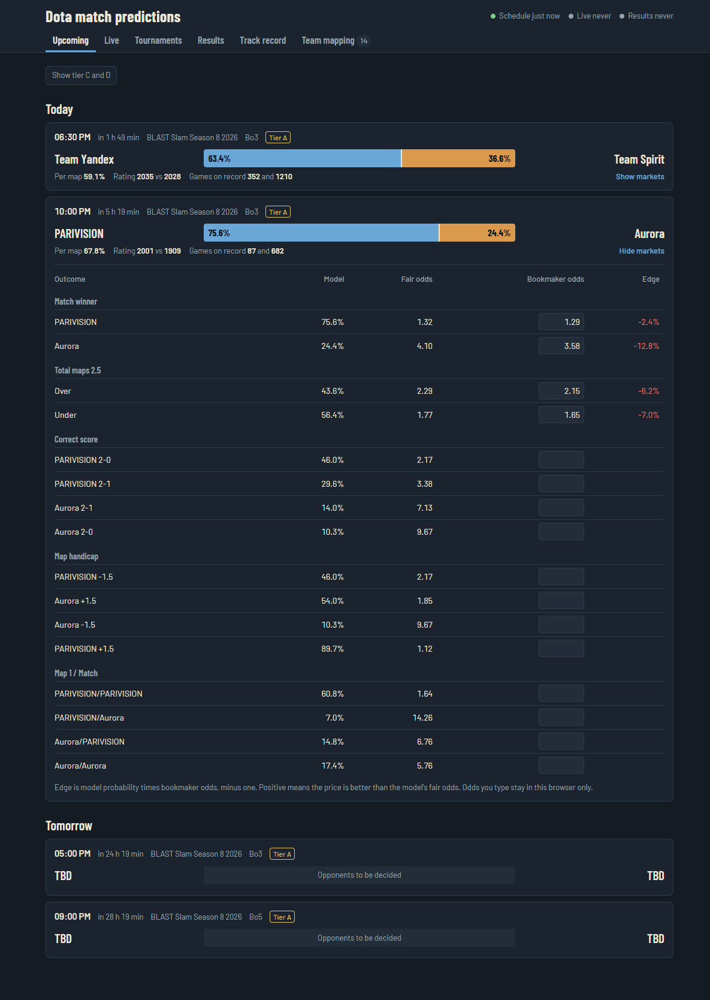
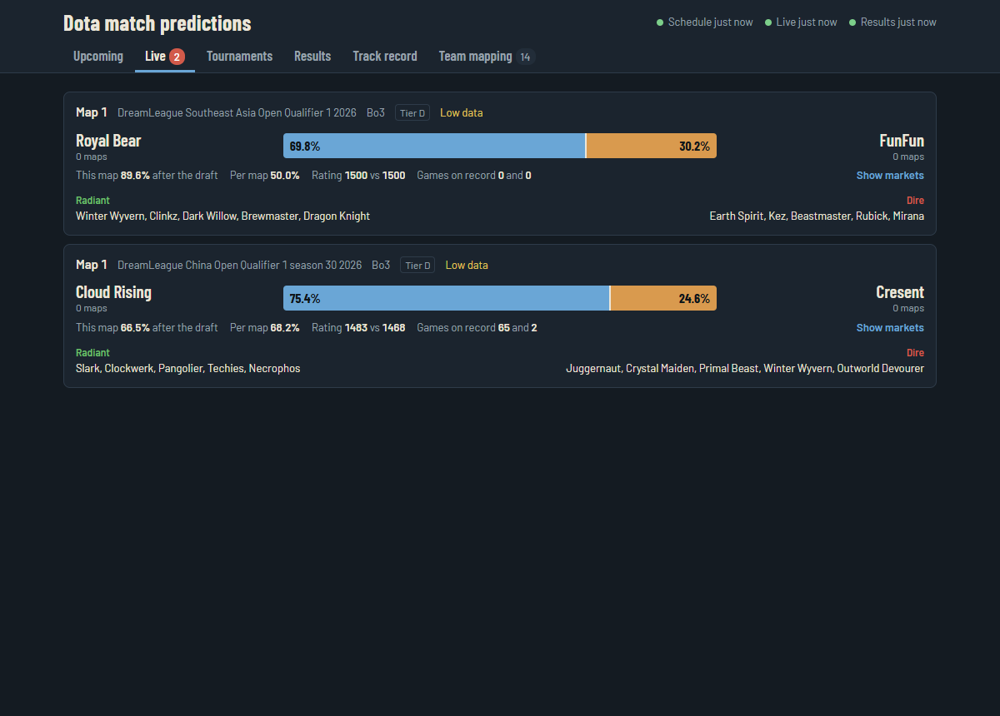
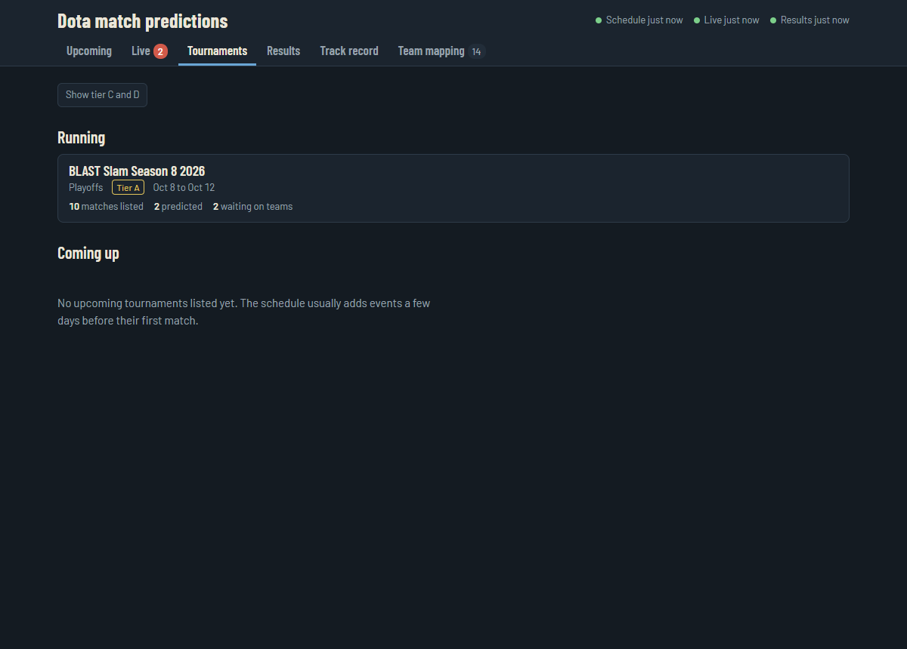
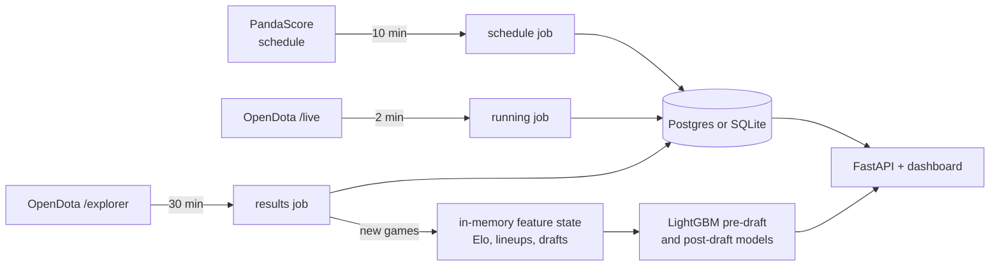

# Dota 2 Match Predictions

Roster-aware, patch-aware win probabilities for professional Dota 2, with a self-updating dashboard.

The service follows the pro schedule on its own. It predicts every match before it starts, updates the prediction live once both drafts are locked in, and grades itself when the series ends. Each match comes with bookmaker-style markets: match winner, correct score, total maps, map handicap and map 1 + match. You can paste a bookmaker's odds next to the model's fair odds to see the edge.



<table>
  <tr>
    <td></td>
    <td></td>
  </tr>
</table>

## What it does

- **Schedule.** Pulls running and upcoming tournaments and matches from PandaScore every 10 minutes, including best-of format and tier.
- **Pre-match predictions.** Side-neutral per-map probability from a LightGBM model trained on about 105,000 pro games, turned into series markets for Bo1, Bo2, Bo3 and Bo5.
- **Live drafts.** Polls OpenDota's live feed every 2 minutes. Once all ten heroes are picked, it predicts the current map with the post-draft model and recomputes the series odds from the live score.
- **Coverage.** Live league games found on OpenDota but missing from the schedule still get a fixture and a prediction. An alert fires if a premium league is being played without appearing in the schedule.
- **Track record.** One prediction per match is locked just before it starts. It is graded when the series ends, with accuracy, Brier score, log loss and a calibration chart.
- **Self-updating ratings.** Finished games are pulled in every 30 minutes and folded into team and player ratings without a full rebuild.
- **Team mapping.** Schedule team names are linked to match history only on exact matches. Anything else waits on the Team mapping tab for one click, because look-alike names are often different teams. Live games also fix links automatically when a scheduled match is being played.

## How it works



Everything runs in one process: the web app, the three job loops and a warm predictor. Rebuilding the feature state from match history takes about 13 seconds and about 700 MB of memory. After that, a prediction takes 1.5 ms.

Training stays offline. You train on your own machine and copy the two model files to the server.

## Quick start (local)

Requires Python 3.12.

```bash
python -m venv .venv
.venv/Scripts/pip install -e ".[dev]"      # Windows; use .venv/bin/pip elsewhere
cp .env.example .env                        # then fill in the values

dota-predictor db bootstrap                 # first fill: every pro match since 2022, about 40-60 minutes
dota-predictor features build               # leakage-free pregame features
dota-predictor train lightgbm               # post-draft model  -> models/lightgbm_pregame_v1.joblib
dota-predictor train lightgbm --pre-draft   # pre-draft model   -> models/lightgbm_predraft_v1.joblib

dota-predictor serve --port 8000            # dashboard at http://localhost:8000
```

The browser asks for a password: use any username and the value of `DOTA_UI_PASSWORD`.

### Command line predictions

```bash
dota-predictor predict match -a "PARIVISION" -b "Aurora" --best-of 3
dota-predictor predict draft -r "Team Spirit" -d "Team Liquid" \
  -rh "Anti-Mage,Magnus,Earthshaker,Crystal Maiden,Puck" \
  -dh "Juggernaut,Tiny,Shadow Fiend,Lion,Rubick"
```

`predict match` prints the series probability and every market with fair decimal odds. On Windows, set `PYTHONIOENCODING=utf-8` if a player name contains characters the console can't print.

## Configuration

| Variable | Required | Purpose |
|---|---|---|
| `DATABASE_URL` | no | Postgres URL. A plain `postgresql://` URL works. Empty means local SQLite in `data/`. `DOTA_DATABASE_URL` wins if both are set. |
| `DOTA_UI_PASSWORD` | for `serve` | Dashboard password. The server refuses to start without it. |
| `DOTA_PANDASCORE_API_KEY` | recommended | Schedule source. Without it, matches appear only once their lobby is live. |
| `DOTA_OPENDOTA_API_KEY` | no | Raises OpenDota's anonymous limit of about 3,000 requests a day. The service uses about 900. |
| `DOTA_MODELS_DIR` | no | Where the two `.joblib` model files are read from. Defaults to `models/`. |
| `DOTA_RAW_STORE_DIR` | no | Where raw API payloads are archived. Defaults to `data/raw/`. |

## Deploying with Dokploy

The repository ships a `Dockerfile` and a `docker-compose.yml`.

1. In Dokploy, create a **Docker Compose** application from this repository.
2. In its **Environment** tab, set `DOTA_UI_PASSWORD`, `DATABASE_URL` and `DOTA_PANDASCORE_API_KEY`.
3. Under **Domains**, point a domain at service `app`, port `8000`.
4. Deploy. On an empty database, the first start fills it from OpenDota, which takes about an hour. The page shows the progress, and predictions start on their own afterwards.
5. Copy your two trained model files to the server, put them on the data volume, then restart the app:

   ```bash
   scp models/*.joblib you@server:/tmp/                           # from your machine
   docker cp /tmp/lightgbm_predraft_v1.joblib <container>:/app/data/models/   # on the server
   docker cp /tmp/lightgbm_pregame_v1.joblib <container>:/app/data/models/
   ```

   Until the models are there, predictions fall back to team Elo ratings.

After each retrain on your machine, repeat step 5. Keep the server on the same code version you trained with, because a model file expects the exact feature list its code produces.

Sizing: Dokploy itself asks for 2 GB of RAM. This app needs about 700 MB more, so 4 GB is comfortable. Run exactly one replica: the job loops and the in-memory state are not meant to be shared.

If your Postgres port is reachable from the internet, restrict it in the server firewall to the machines that need it.

## Model

Features are computed strictly as-of game start by replaying games in order (`features/asof.py`). The same `PregameFeatureState` serves training, the CLI and the live service, so there is no train/serve skew.

- **Ratings:** team Elo and games played, player Elo averaged over the actual five-player lineup, lineup continuity, pairwise co-play.
- **Draft:** hero win rates (global and patch-shrunk), counter and synergy scores, meta pick volume, player–hero comfort and experience, hero pool breadth.
- **Context:** form, rest, head-to-head with shrinkage, days since patch, games on patch, side bias.

Training uses a chronological train / validation / test split, Radiant–Dire mirror augmentation, early stopping and isotonic calibration on the validation block. The pre-draft variant drops every hero feature and is used for upcoming matches.

### Walk-forward (4 expanding folds, 104,938 games)

| Model | Log loss | Brier | Accuracy | ROC AUC | ECE | Premium acc |
|---|---|---|---|---|---|---|
| Elo baseline | 0.6726 | 0.2397 | 58.4% | 0.620 | 0.035 | 63.6% |
| LightGBM | **0.6443** | **0.2269** | **61.3%** | **0.668** | **0.014** | **63.8%** |

Final holdout (most recent 20,987 games, 2025-04 to 2026-10): LightGBM 63.0% accuracy and 0.631 log loss, against Elo's 59.1% and 0.669. Player Elo over the actual lineup is the strongest single feature, at 47% of gain.

### Confidence tiers (holdout)

| Confidence | Coverage | Accuracy |
|---|---|---|
| all games | 100% | 63.0% |
| P ≥ 0.60 or ≤ 0.40 | 49% | 72.1% |
| P ≥ 0.70 or ≤ 0.30 | 21% | 80.1% |
| P ≥ 0.80 or ≤ 0.20 | 11% | 84.7% |

Pre-game professional Dota is close to a coin flip between evenly matched rosters, and published pre-game models land between 60% and 66%. Trust the calibrated probability and the dashboard's own track record over the headline accuracy.

### Known limits

- Series markets treat maps as independent with a constant per-map probability.
- A team with no players on record gets a team-Elo-only prediction and a low-data flag. The model would otherwise extrapolate to extreme values.
- PandaScore tends to list matches only a few days ahead, so far-future events appear late.
- OpenDota's live feed lags the broadcast by a few minutes, so draft predictions arrive just after the draft ends on stream.

## Data

| | |
|---|---|
| Games | about 105,000 (2022-01 to 2026-10, premium and professional leagues) |
| With heroes and players | 100% (ten participants each) |
| Canonical players / teams | 28,251 / 6,607 |
| Patches | resolved by match time, letter-level (7.41b) |

Sources and terms:

- **OpenDota** match history comes from the public `/explorer` SQL endpoint. A full backfill takes about 110 requests. Every raw payload is archived gzipped with provenance.
- **PandaScore** supplies the schedule. Check its terms of use before any betting-related use.
- **Liquipedia** is not used. Its terms forbid scraping, and API access needs approval.

## Project layout

```
src/dota_predictor/
  ingest/      OpenDota REST, explorer and live feed, PandaScore, Valve patches, rate limiting
  normalize/   canonical teams, players and patches; games, lineups; schedule team links
  features/    PregameFeatureState (Elo, draft, mastery, meta), incremental folding
  modeling/    LightGBM trainer, walk-forward evaluation, confidence tiers
  predict/     LiveDraftPredictor, series markets, PredictionService (log and grading)
  service/     FastAPI app, background jobs, coverage alerts, static dashboard
  storage/     schema (SQLAlchemy Core), dialect-aware upserts, raw payload store
  pipeline.py  bootstrap and normalization pipelines shared by the CLI and the server
```

## Development

```bash
.venv/Scripts/python -m pytest      # 87 tests, SQLite only; never touches DATABASE_URL
.venv/Scripts/ruff check src tests
```

Design notes live in `docs/superpowers/`.

## Principles

1. Prediction time is sacred: features only use information knowable before the cutoff.
2. Games, series and tournaments are separate entities.
3. An organization is not a roster: actual five-player lineups per game.
4. Raw data is immutable: gzipped payloads with provenance.
5. Unknown is not zero: explicit missingness and confidence flags.
6. Predict probabilities, then test calibration in the open.

## Disclaimer

This is a research project. Predictions are probabilities, not advice, and nothing here is betting advice.
